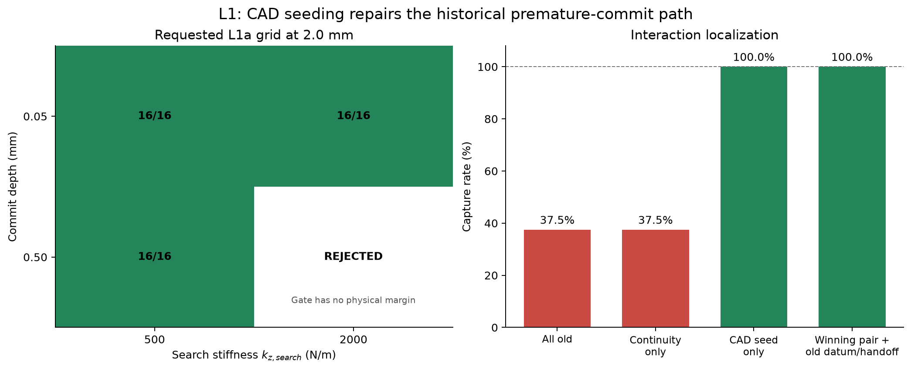
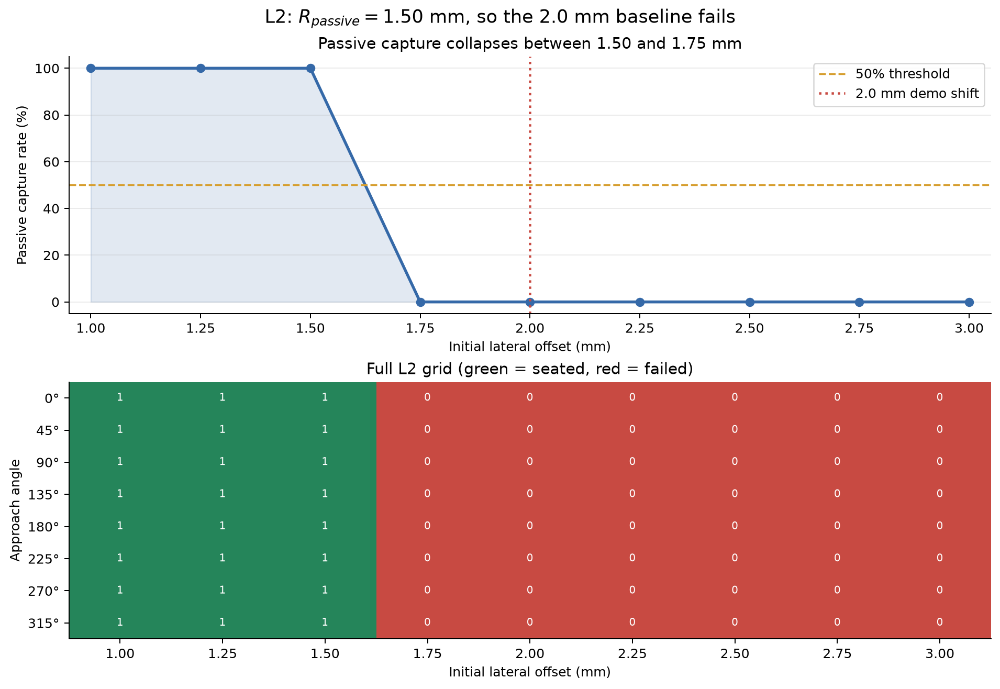
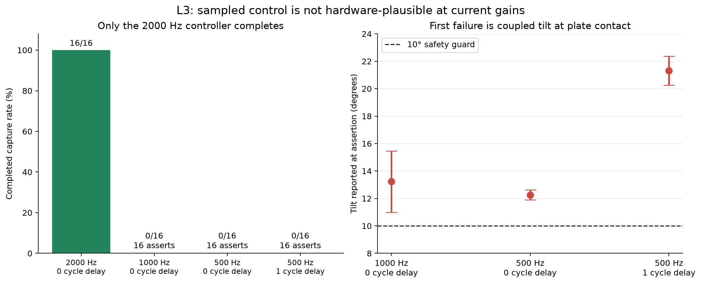

# Chunk 1 engineering report

Date: 2026-08-08

Repository: `pinn_mvp`

Implemented and documented commit range: `312345f` through `9d60fa4`

## Executive outcome

Chunk 1 established three things:

1. The repository is deterministic, tested, and explicit about every
   load-bearing configuration value.
2. The loose-clearance configuration remains a valid demonstration config:
   passive playback fails decisively at the required 2.0 mm fixture shift,
   while active search captures 16/16 directions at that shift.
3. The current Cartesian impedance loop is **not hardware-rate plausible**.
   It succeeds at 2000 Hz but trips the existing tilt guard in 16/16 trials at
   1000 Hz and 500 Hz. The first failure occurs at plate contact, before the
   seating gate or seating-axis gain is active.

No estimator, taught-position baseline, recovery run, recording, tight-
clearance configuration, or large reliability sweep was built in this chunk.

## Canonical configuration measured

All accepted Chunk 1 measurements use the following configuration unless a
cell explicitly states an override.

| Group | Value |
|---|---|
| Task | peg radius 5 mm; radial clearance 0.5 mm; chamfer 1 mm; plate 10 mm; peg mass 50 g; friction 0.4; 16 radial segments; blind hole |
| Solver | timestep 0.0005 s; elliptic cone; `implicitfast`; `solref=(0.002, 1)`; `solimp=(0.9, 0.95, 1e-4)` |
| Translational gains | `k_xy=1000 N/m`; `k_z_search=500 N/m`; `k_z_seating=2000 N/m` |
| Rotational gains | `k_rx=k_ry=5 N·m/rad`; `k_rz=0.05 N·m/rad` |
| Axial profile | search force 1 N; target force 15 N; yield limit 25 N; descent 10 mm/s |
| Commit gate | 0.5 mm below `z_flat`; release at 0.7×; `z_flat` EMA time constant 0.5 s |
| Spiral | tangential speed 5 mm/s; pitch 0.75 mm; outer radius 2.75 mm; coverage arc 31.62 mm |
| Episode | start height 5 mm; maximum duration 16.3 s; 100 ms persistent seating criterion |
| Grading | target depth 9.86 mm; lateral penetration allowance 12 µm |
| Control timing | decimation 1 = 2000 Hz; zero delay |

The contact model was deliberately unchanged. No result in this report changes
`solref`, `solimp`, timestep, cone type, or integrator.

## Evidence and reproducibility

Measurement drivers:

- L1: [`measure_l1_attribution.py`](../scripts/measure_l1_attribution.py)
- L2: [`measure_l2_passive_radius.py`](../scripts/measure_l2_passive_radius.py)
- L3: [`measure_l3_control_rates.py`](../scripts/measure_l3_control_rates.py)

Raw results:

- [`chunk1_l1_attribution.csv`](data/chunk1_l1_attribution.csv)
- [`chunk1_l2_passive_grid.csv`](data/chunk1_l2_passive_grid.csv)
- [`chunk1_l3_control_rate.csv`](data/chunk1_l3_control_rate.csv)

Reproduction commands:

```bash
uv run pytest -q
uv run python scripts/measure_l1_attribution.py
uv run python scripts/measure_l2_passive_radius.py
uv run python scripts/measure_l3_control_rates.py
uv run python scripts/render_chunk1_report_figures.py
```

The measurement scripts construct `EpisodeConfig` variants and call
`run_episode`; none contains a second physics loop.

---

## Engineering decisions

### D1. Use one commit gate for one physical event

Problem: spiral pause and seating transition described the same physical event
with separate constants. The old shallow pause threshold sat inside the
near-hole depth-excursion band, so the controller often stopped searching
before capture.

Decision: `depth_commit` controls both spiral pause and the transition from
search stiffness/force to seating stiffness/force. A 0.7× release threshold
adds hysteresis.

Defense:

- Two thresholds for one event can drift independently; that is the exact
  stale-constant failure mode already seen repeatedly in this project.
- Hysteresis prevents contact chatter from rapidly switching both the spiral
  and axial stiffness.
- The gate is tested as a physical relationship, not merely as a literal:
  `depth_commit < 0.5 * f_search / k_z_search`.
- The lower separation from ordinary resting depth is checked against measured
  settling data through `measure_settling_depths`.

Rejected alternatives:

- Pause on any contact: table contact is continuous during sliding and freezes
  the spiral.
- Pause on lateral force: Coulomb sliding lives near `mu*N`, so the condition
  flickers at its own threshold.
- Keep independent pause and seating thresholds: preserves the drift hazard.
- Weaken the reachability assert to fill the L1 grid: would create a physically
  impossible cell and turn an invalid configuration into misleading data.

### D2. Separate search and seating axial stiffness

Problem: with `f_search=1 N` and `k_z=2000 N/m`, the search reference has only
0.5 mm of descent allowance. A robust commit threshold cannot fit between
ordinary depth excursions and half that allowance.

Decision: use `k_z_search=500 N/m` during search and `k_z_seating=2000 N/m`
after commit.

Defense:

- Search remains at the same 1 N contact force while its kinematic descent
  allowance increases to 2 mm.
- Seating retains the stiff gain required for accurate 15 N regulation.
- Both gains receive the existing explicit-integration stability check.
- `k_z_search` has no default because it and `f_search` jointly define the
  reachable gate interval.

Rejected alternative: increase search force. That increases friction
proportionally and degrades the lateral breakaway budget without fixing the
underlying threshold coupling.

### D3. Seed `z_flat` from CAD nominal and filter in physical time

Problem: the historical baseline began latching when the falling tip crossed
`z=+1 mm`, without requiring contact. In the reproduced failure at 90°, it
committed at 0.416 s while the tip was still `+0.940 mm` above the plate and
`z_flat=+0.995 mm`.

Decision: initialize `z_flat=0` from the CAD plate datum. Refine it only while
contact exists and measured depth remains inside a band that cannot include a
committed descent. Express the EMA as `dt_control / 0.5 s`, not as a fixed
per-step alpha.

Defense:

- CAD nominal is available in the part program and does not rely on simulator
  ground truth beyond the same nominal geometry the controller already uses.
- Requiring contact prevents a falling free-space sample from becoming a
  surface datum.
- A time constant preserves filter physics when the control period changes.
- L1 interaction measurements show this is the single change that restores
  6/16 to 16/16 from the exact all-old state.

Hardware limitation: CAD seeding is not a substitute for touch-off. Real
hardware still needs a contact-based datum routine before deployment.

### D4. Preserve force across the search-to-seat stiffness change

Problem: holding position error while switching stiffness multiplies the
spring force. With a 4× stiffness change, an ordinary nonzero search error can
become an instantaneous force command step.

Decision: on a phase edge, compute the current spring force using the old gain,
then re-reference the setpoint under the new gain so that force is unchanged.
Ramp a force leash toward the phase goal at the rate implied by
`v_descent * k_z`.

Defense:

- The stiffness transition becomes invisible to the commanded spring force.
- Force and position ramps share one physical rate and cannot drift.
- A permanent regression test limits the command step around a transition.

L1 showed that force continuity was not the capture-rate carrier: the old
shallow/stiff pair remained 6/16 even when continuity alone was enabled, while
CAD seeding alone reached 16/16. Force continuity remains justified as a
hardware-safety and command-quality decision.

### D5. Make load-bearing parameters explicit

Decisions:

- Remove the `ImpedanceGains.k_z=2000` default.
- Keep `k_xy`, `k_rx`, and `k_ry` required.
- Remove the `SpiralSpec.v_t=0.005` default.
- Keep `InsertionProfile.k_z_search` and `f_search` required.
- Put `z_start`, `v_t`, `r_cap_dyn`, `pen_allow`, `max_seconds`, commit depth,
  and control timing in the named validated bundle.

Defense: these values define coupled behavior. A plausible-looking class
default silently creates an unmeasured combination when another value changes.
Requiring the value at construction makes configuration provenance visible at
every call site.

The initial full-suite failure—12 stale `SpiralSpec.v_t` call sites—validated
the hazard. Every surviving call site now states the required value.

### D6. Derive the lateral grading allowance from lateral evidence

Problem: the prior 37.035 µm `pen_allow` was 1.5× the 24.7 µm **axial** floor
penetration, even though it relaxed a **lateral** containment test.

Decision: use `1.5 * 8 µm = 12 µm`, derived from measured seated lateral
interpenetration.

Defense:

- The allowance now describes the dimension it grades.
- A permanent assert requires `pen_allow < 0.2 * clearance`; otherwise the
  geometric containment criterion becomes too permissive to distinguish a
  valid seat.
- At 0.5 mm clearance, the vacuity ceiling is 100 µm, leaving substantial
  margin over the 12 µm allowance.

### D7. Derive target depth from the measured stop residual

Problem: `plate_thickness - 1 mm` could call a peg seated while it remained a
full millimeter above the blind-hole floor. The 1 mm had no measurement behind
it.

Decision: use a 0.14 mm margin: twice the measured approximately 0.07 mm
15 N stop residual. The default target depth is therefore 9.86 mm for a 10 mm
plate.

Defense:

- The threshold is traceable to the physical stop measurement.
- A 100% measurement margin admits approach-angle variation while remaining an
  order of magnitude tighter than the removed 1 mm literal.
- The threshold affects grading only; it does not drive control.

### D8. Assert plate extent against the actual worst search position

Problem: plate radius had been derived through a historical factor tied to an
old capture-radius sweep. That factor could become too small when search reach
changed.

Decision: assert
`plate_outer_radius >= delta_max + R_spiral + peg_radius`.

Defense: this is the actual geometric requirement: at the largest possible
initial error and furthest outward spiral point, the entire peg footprint must
remain supported by the plate.

### D9. Treat episode reset as an explicit API contract

Decision: every `run_episode` begins with `mj_resetData`, applies the requested
initial `qpos`, then calls `mj_forward` before the first control evaluation.

Defense:

- Future multi-episode runs may deliberately preserve estimator state, but no
  MuJoCo state may leak across episodes.
- `mj_forward` populates contacts, transforms, bias forces, and other derived
  quantities before control reads them.
- A test runs the same configuration twice and compares array bytes, scalar
  IEEE-754 representations, shapes, dtypes, and nonnumeric fields.
- The passed frozen configuration and all nested config objects remain
  unchanged.

Rejected alternative: add a random seed. The simulator has no random input in
this configuration; a seed would hide rather than fix state leakage.

### D10. Enforce time globally, not through search exhaustion

Decision: compute `n_steps = int(max_seconds / dt)` once and use that as the
unconditional physics-loop bound.

Defense: straight-drop and later taught-position baselines have no spiral to
exhaust. They must still terminate with `seated=False` and
`time_to_seat_s=inf`.

### D11. Delete obsolete executable control laws

Ten scripts independently stepped physics using a control law that no longer
exists. They were removed in commit `dbed1a1`, separate from behavior changes:

```text
measure_b0_dwell_direct.py
measure_b0_lag_dwell.py
measure_c2a_dynamic_capture_radius.py
measure_d1_spiral_diagnostics.py
measure_d2_theta0_sweep.py
measure_e3_search_phase_sweep.py
measure_e6_probe_vs_spiral.py
measure_f7_coupled_mode_stability.py
measure_h1_hinge_axis_rotation.py
render_d3_trajectories.py
```

`ProbeSpec` and its tests were also deleted because nothing referenced it.

Defense:

- `run_episode` must be the sole physics loop so diagnostics cannot silently
  measure stale behavior.
- Findings remain recoverable in git history.
- Keeping deletion separate from behavior changes preserves useful `git
  bisect` boundaries.

### D12. Decimate the complete controller and use a true zero-order hold

Decision: on each control tick, evaluate sensing-dependent controller state,
the commit gate, EMA, spiral integration, force ramp, position ramp, impedance
wrench, Jacobian mapping, and bias compensation. Use
`control_period = control_decimation * physics_dt` for all rates. Hold the
resulting generalized-force vector exactly between ticks.

Defense:

- Decimating only the search reference while recomputing damping at physics
  rate would not model a slower controller; it would retain an unrealistically
  fast stabilizing path.
- Advancing rate limits by physics `dt` only on sparse ticks would slow the
  commanded trajectory by the decimation factor. Using `N*dt` preserves
  physical speeds.
- Holding generalized force models the command actually delivered to a lower-
  level torque interface.
- Decimation itself is not counted as a spiral pause; pause metrics describe
  controller intent, not expected zero-order holding.

Diagnostic fields `control_tick` and `qfrc_applied` allow exact tests of tick
placement and held output.

### D13. Model latency as whole control cycles

Decision: `control_delay_steps=1` queues the newly evaluated command and applies
the previous control tick's command. Before the first delayed command is
available, the applied vector is zero.

Defense:

- The requested experiment is a one-cycle, 2 ms latency at decimation 4, not a
  single 0.5 ms physics-step delay.
- The queue semantics generalize to larger integer delays without changing the
  controller.
- Tests verify that steps 4–7 in a delayed run exactly equal steps 0–3 of the
  corresponding immediate run.

### D14. Keep 2000 Hz as default after measured lower-rate failure

Decision: do not set decimation 4 as the canonical default.

Defense:

- All 16 trials at both 1000 Hz and 500 Hz hit the existing 10° tilt safety
  guard. Delayed 500 Hz is worse.
- The failure begins at plate contact. At 1000 Hz and the 0° approach, tilt is
  0.142° at 0.50 s and exceeds the guard by 0.52 s.
- This precedes commit, seating stiffness, and the seating force ramp. The first
  broken quantity is therefore coupled lateral/rotational stability, not
  `D_z`, `K_z`, or commit-gate tracking.
- Removing or weakening the tilt guard to obtain force metrics would replace a
  measured instability with invalid post-failure data.

The 2000 Hz default is simulation-validated but must not be described as
hardware-plausible. Sampled-control remediation is now a blocking hardware
work item.

### D15. Keep agent configuration local without rewriting history

Decision: remove `.claude/CLAUDE.md` and `.claude/settings.json` from the
current git index, preserve both files on disk, and ignore the complete
`.claude/` and `.agents/` trees.

Defense:

- These files configure one developer's local agent environment; they do not
  define the simulation or its reproducibility contract.
- Ignoring the directories prevents future nested caches, skills, and settings
  from leaking into product commits.
- `git rm --cached` removes tracking without deleting the working copies.
- Repository history was not rewritten. Purging earlier objects would change
  every descendant commit ID and disrupt clones; that is a destructive,
  repository-wide operation distinct from stopping current and future tracking.

The existing `data/` ignore was also anchored to `/data/`. Runtime episode
artifacts at the repository root remain ignored, while reviewed evidence under
`docs/data/` can be committed and reproduced.

### D16. Retain diagnostics only as production-loop callers

Several previously untracked diagnostic drivers were committed because the
requested handoff included every non-local workspace change. Before inclusion,
each was checked against the current API and changed to read start height,
spiral, timeout, penetration allowance, and control timing from
`VALIDATED_LOOSE_V1`.

The H4 diagnostic no longer imports the deleted shallow depth gate or infers
pause state from a duplicate threshold. It reads the `searching` and
`spiral_advanced` fields emitted by `run_episode`. All retained drivers call
the production runner; none steps MuJoCo itself.

`measure_p1_capture_localization.py` is retained source only. It was not run in
Chunk 1, and no estimator, learned policy, baseline, recovery behavior, or new
result was created from it.

---

## L1 — capture attribution



### Requested 2×2 grid

| Commit depth | `k_z_search=500` | `k_z_search=2000` |
|---|---:|---:|
| 0.05 mm | 16/16 | 16/16 |
| 0.50 mm | 16/16 | rejected |

The rejected cell has a 0.50 mm total descent allowance, so the asserted half-
allowance is only 0.25 mm. A 0.50 mm gate cannot fit.

### One-at-a-time reversals at the canonical winning pair

| `z_flat` mode | Force-continuous handoff | Capture |
|---|---|---:|
| CAD nominal | on | 16/16 |
| historical mid-fall latch | on | 16/16 |
| CAD nominal | off | 16/16 |

The requested one-at-a-time grid by itself does not reproduce an 85% cell.
Additional bounded interaction cells were required to avoid an unsupported
“conjunctive” conclusion.

### Interaction localization

| State | Capture |
|---|---:|
| All four historical behaviors | 6/16 |
| Old gate/stiffness + old latch + continuity on | 6/16 |
| Old gate/stiffness + CAD seed + continuity off | 16/16 |
| Winning gate/stiffness + old latch + continuity off | 16/16 |

Conclusion: the exact historical “85%” premise did not reproduce at the
requested 2.0 mm offset; the all-old result was 37.5%. Within the reproduced
comparison, CAD seeding is the single carrier from the all-old state. Its
effect is conditional: the softer/deeper winning pair is robust even to both
old axial-state behaviors.

Mechanism: the old datum latches in free fall, makes depth appear positive
before contact, fires the shallow gate in mid-air, switches phase, and pauses
nearly the entire search. This is a threshold/reference artifact, not a
capture-geometry improvement.

---

## L2 — passive capture radius



Search was disabled with `spiral_spec=None`. Eight angles were run at every
0.25 mm offset from 1.0 through 3.0 mm.

| Offset | Capture |
|---:|---:|
| 1.00 mm | 8/8 |
| 1.25 mm | 8/8 |
| 1.50 mm | 8/8 |
| 1.75 mm | 0/8 |
| 2.00 mm | 0/8 |
| 2.25 mm | 0/8 |
| 2.50 mm | 0/8 |
| 2.75 mm | 0/8 |
| 3.00 mm | 0/8 |

Measured `R_passive=1.50 mm`; the first tested offset below 50% is 1.75 mm.
The demonstration's 2.0 mm taught-position playback fails 0/8, so passive
funneling cannot erase the intended baseline/recovery contrast.

Engineering decision: retain the loose configuration for the next chunk. No
clearance, chamfer, solver, or force parameter was changed to manufacture a
baseline failure.

---

## L3 — control-rate and latency gate



| Decimation | Rate | Delay | Completed capture | Settled `|Fz|` | Peak `|Fz|` | Max first-200 ms `|Fz|` excursion |
|---:|---:|---:|---:|---:|---:|---:|
| 1 | 2000 Hz | 0 | 16/16 | 14.950592 N | 14.951185 N | 4.180515 N |
| 2 | 1000 Hz | 0 | 0/16; 16 tilt assertions | unavailable | unavailable | unavailable |
| 4 | 500 Hz | 0 | 0/16; 16 tilt assertions | unavailable | unavailable | unavailable |
| 4 | 500 Hz | 1 cycle | 0/16; 16 tilt assertions | unavailable | unavailable | unavailable |

The 2000 Hz settled-force range across angles is
14.950554–14.950633 N. Time to seat is 2.0150–3.1525 s. The 4.180515 N
post-seat excursion is the largest peak-to-peak absolute-force change in the
first 200 ms after the confirmed seating onset; it includes the monotonic
seating ramp and is not evidence of sustained ringing.

Assertion tilt ranges:

| Cell | Tilt reported at assertion |
|---|---:|
| 1000 Hz | 10.99–15.47° |
| 500 Hz | 11.90–12.62° |
| 500 Hz, one-cycle delay | 20.26–22.38° |

No settled or peak-force metric is reported for assertion-only cells because
the episodes terminate at the safety boundary. Treating those partial traces
as completed trials would be misleading.

---

## Tests and invariants added or strengthened

The final suite contains 100 passing tests. Relevant permanent coverage
includes:

- explicit required-gain and required-search-speed construction sites;
- commit-gate upper-bound rejection;
- measured settling-depth lower-bound validation;
- search force-budget validation;
- force continuity around stiffness transitions;
- commit hysteresis release behavior;
- lateral grading allowance vacuity rejection;
- measured target-depth derivation;
- bit-identical consecutive episodes;
- config immutability across episodes;
- no-spiral global timeout behavior;
- exact control-tick placement;
- exact zero-order hold between control ticks;
- exact one-cycle command delay;
- plate outer-radius coverage of the worst search position.

Baseline suite before repairs: 81 passed, 12 failed.

L0a suite after stale-constructor repair: 94 passed.

Final documentation-handoff suite: 100 passed in 32.38 s.

No randomness was introduced to make determinism pass.

---

## Commit-by-commit traceability

| Commit | Purpose | Why separate |
|---|---|---|
| `312345f` | Lock validated controller/config, repair required construction sites, correct grading derivations, add diagnostics and asserts | Behavior/config repair had to be green before deletion work |
| `dbed1a1` | Delete ten obsolete physics-loop scripts and `ProbeSpec` | Keeps deletion separate from behavior for useful bisection |
| `f1ce1dd` | Explicit episode reset, determinism/config-immutability tests | Isolates the multi-episode contract |
| `334074e` | Parameterize gate and attribution controls | Makes requested experimental cells constructible without changing canonical defaults |
| `a52665f` | Reproduce exact historical datum and handoff semantics; add L1 driver | Invalid initial toggle semantics were discarded before accepting results |
| `f85b85f` | Add interaction diagnostics | Supports the carrier/mechanism conclusion rather than inferring it |
| `9e8eb55` | Add passive-radius grid | Reproducible L2 evidence |
| `e2f0ba5` | Implement decimation, zero-order hold, delay, logs, and tests | Core L3 behavior independent of measured result |
| `c6109d6` | Add control-rate measurement driver | Reproducible L3 evidence |
| `f153063` | Correct root context and pin L1/L2 timing provenance | Prevents later default changes from silently rewriting earlier results |
| `5d82475` | Stop tracking local agent configuration | Preserves local files while separating repository hygiene from documentation |
| `9d60fa4` | Preserve and currentize non-loop diagnostic drivers | Keeps source handoff separate from generated evidence and prose |

## Context corrections made

The original context file was under `docs/` despite being described as a root
contract, and it contained stale claims. It was moved to repository root and
corrected to reflect:

- `k_z` and `v_t` have no defaults;
- `pen_allow` is 12 µm and comes from lateral evidence;
- target-depth margin is 0.14 mm, not 1 mm;
- `R_passive=1.50 mm` is current, not stale;
- L1 is attributed to the mid-fall datum mechanism, with the non-reproduced
  historical rate called out explicitly;
- sampled control fails at 1000/500 Hz and remains a hardware blocker;
- `run_episode` returns a result dictionary; there is no `TrialResult` class.

## Remaining engineering risks

1. Sampled coupled impedance must be redesigned or retuned before hardware.
   Do not hide the failure by weakening the tilt guard or contact model.
2. Hardware needs an explicit touch-off routine; CAD `z_flat` is simulation-
   appropriate but not a physical datum-establishment procedure.
3. The independent safety watchdog remains unimplemented.
4. `F_wedge` remains uncalibrated because this regime contains no observed jam
   population.
5. The earlier 96-trial 100% result predates the final 12 µm grading allowance
   and 0.14 mm target-depth margin. Chunk 1 revalidated 16/16 at the 2.0 mm demo
   shift, not the entire 96-trial historical sweep.

These are explicit blockers or limitations, not invitations to silently change
the load-bearing solver configuration.
