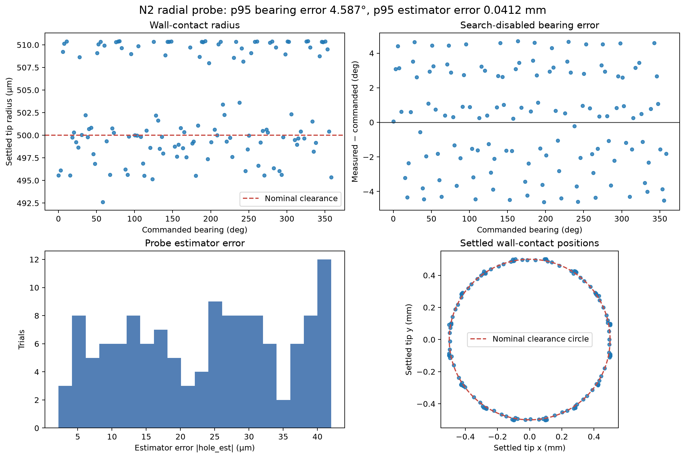
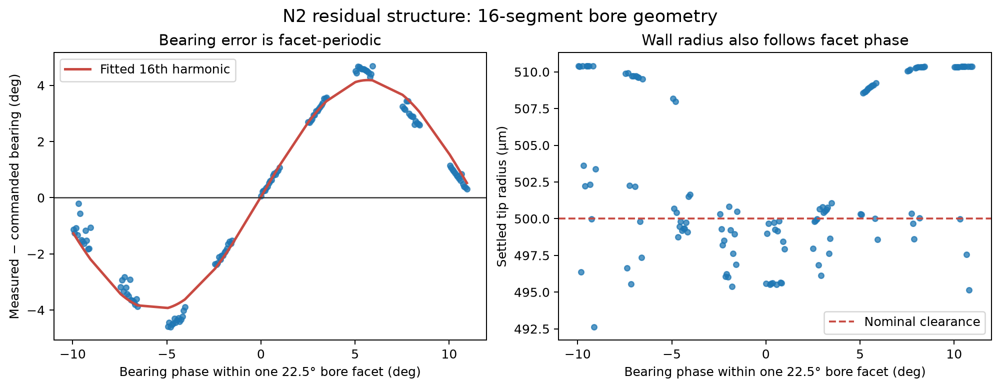

# N2 search-disabled radial probe report

Date: 2026-08-08

Repository state entering N2: `407d9ce` (`101 passed`)

Measurement driver: `3ad18a0`

## Outcome

The redesigned measurement primitive is viable at the simulated 2000 Hz
control rate. Search-disabled 1.0 mm radial probes seated in 128/128 trials.
The estimator

```text
hole_est = settled_tip_xy - clearance * u_probe
```

had 0.02345 mm mean error, 0.04121 mm p95 error, and 0.04199 mm maximum error.
The maximum is 8.40% of both the 0.5 mm clearance and the independent 0.5 mm
fault threshold, leaving 11.91× threshold-to-error margin.

Disabling the spiral reduced the search-on M2a bearing deviation from about
11.0° to 4.587° p95 and 4.699° maximum. The remaining error is not a constant
frame offset: it is dominated by the 16-fold bore-facet geometry, with a
4.088° fitted 16th-harmonic amplitude and only a 0.102° constant offset.

This result validates the primitive's useful error scale. It does not validate
a production probe cycle or any downstream filter.

## Full measured configuration

| Group | Value |
|---|---|
| Task | peg radius 5 mm; radial clearance 0.5 mm; chamfer 1 mm; plate 10 mm; peg length 50 mm; peg mass 50 g; friction 0.4; 16 radial segments; blind hole |
| Solver | timestep 0.0005 s; elliptic cone; `implicitfast`; `solref=(0.002, 1)`; `solimp=(0.9, 0.95, 1e-4)` |
| Translational gains | `k_xy=1000 N/m`; `k_z_search=500 N/m`; `k_z_seating=2000 N/m` |
| Rotational gains | `k_rx=k_ry=5 N·m/rad`; `k_rz=0.05 N·m/rad` |
| Axial profile | search force 1 N; target force 15 N; yield limit 25 N; descent 10 mm/s |
| Commit gate | 0.5 mm below `z_flat`; release at 0.7×; `z_flat` EMA time constant 0.5 s |
| Episode | start height 5 mm; target-depth margin 0.14 mm; maximum 16.3 s; 100 ms seating persistence |
| Grading | `pen_allow=12 µm`, passed explicitly |
| Control timing | decimation 1 = 2000 Hz; zero delay |
| Probe | radius `2 × clearance = 1.0 mm`; 128 golden-angle bearings; spiral disabled |
| Measured bounds | `R_passive=1.5 mm`; `R_cap_dyn=1.6 mm`; probe lies inside both |

No `solref`, `solimp`, timestep, cone, integrator, gain, force, geometry, or
grading value was changed.

## Why the controller was not changed

M2a found that the controller snaps `xy_des` to the measured tip at capture.
That zeroes lateral spring force before bore descent and permits passive
self-alignment under the axial command. The first commit in the diagnostic
already had only 0.106 mm of spring error, below the proposed 0.5 mm inference
gate. Latching the earlier spiral coordinate would add lateral load without
recovering reliable direction information.

The estimator was therefore changed conceptually, not the controller. Probe
direction is deliberately commanded and known. The settled tip supplies the
wall-contact point; subtracting one clearance radius along the known direction
supplies the hole-center estimate. There is no spring-error gate, slack branch,
or descent-dependent chamfer correction.

## Engineering decisions

### D1. Treat N1 as offline measurement geometry

The code added here is a characterization driver, not a production probe
feature. It constructs ordinary `EpisodeConfig` objects and calls
`run_episode`; it does not add controller state, sequencing, or another physics
loop.

### D2. Derive the probe radius from geometry

The radius is exactly `2 * radial_clearance = 1.0 mm`, not a disconnected
literal. Runtime asserts require

```text
clearance < probe_radius < measured R_passive
probe_radius < R_cap_dyn
```

The first relationship makes wall contact possible. The second and third keep
the probe inside measured passive and dynamic capture bounds.

### D3. Disable search structurally

Every N2 episode has `spiral_spec=None`, with a preflight assertion over all
128 configurations. This removes the tangential motion observed in M2a while
retaining the production insertion controller.

### D4. Reuse MuJoCo state only when scene inputs are invariant

The driver asserts that all trials share the exact `EpisodeConfig` fields that
enter MJCF construction: task, solver, and plate tilt. Initial polar offset and
bearing affect only initial `qpos` and the commanded nominal. Each worker calls
`build_episode_model_data` once; `run_episode` resets that worker's `MjData`
before every trial.

### D5. Keep multiprocessing and persistence deterministic

Workers receive only trial index and bearing, then return plain Python
primitives. Futures are mapped back to submitted indices. The main process
alone writes JSONL and flushes each record. Analysis asserts exactly 128 unique,
contiguous indices before computing statistics.

### D6. Use commanded direction, not an observed proxy

The estimator subtracts `clearance * [cos(commanded), sin(commanded)]` from the
settled tip and explicitly subtracts `true_hole_xy` when grading. It does not
hardcode the current origin convention, infer direction from spring error, or
infer direction from the measured tip bearing.

### D7. Use golden-angle bearings

The bearing sequence is `i * π(3-√5)`. A 22.5° grid would repeatedly sample the
same phase of the 16-segment bore and hide the dominant residual found here.

### D8. Report population statistics for the designed finite grid

All reported standard deviations use `ddof=0`. These 128 deterministic points
are the complete designed N2 bearing population, not a random sample used to
infer another distribution.

## Measurements



### Capture and exclusions

| Trials | Seated | Excluded |
|---:|---:|---:|
| 128 | 128 | 0 |

The 100% result matches the prediction for a 1.0 mm offset inside the measured
1.5 mm passive-capture radius.

### Wall-contact radius

| Statistic | Settled tip radius |
|---|---:|
| Mean | 502.999996 µm |
| Population standard deviation | 5.578743 µm |
| Minimum | 492.613106 µm |
| p95 | 510.379413 µm |
| Maximum | 510.413630 µm |

The 17.8005 µm total range is wider than the predicted “few µm,” so that
prediction is falsified. It is not wide or bimodal evidence of missed wall
contact: the radius follows facet phase and every trial lies within about
10.4 µm of nominal clearance.

### Bearing error — headline

| Statistic | Absolute bearing error | Implied lateral error at 0.5 mm radius |
|---|---:|---:|
| Mean | 2.533678° | 22.096557 µm |
| p95 | 4.587280° | 39.988815 µm |
| Maximum | 4.699025° | 40.960773 µm |

Signed bearing error has mean `+0.132846°`. Search-disabled probing therefore
reduces the approximately 11° M2a drift, but does not produce zero error.



The broad commanded-bearing correlation is weak (`Pearson r=-0.0714`). Folding
the data into one 22.5° facet reveals the mechanism directly: the fitted 16th
harmonic has 4.087712° amplitude and 0.101568° constant offset. The residual is
the discretized bore geometry, not a global bearing-frame or sign error.

### Hole estimator error

| Statistic | `|hole_est - true_hole_xy|` | Fraction of 0.5 mm threshold |
|---|---:|---:|
| Mean | 0.023453 mm | 4.691% |
| p95 | 0.041205 mm | 8.241% |
| Maximum | 0.041994 mm | 8.399% |

The maximum-error margin to the fault threshold is 11.91×. No calibration or
facet correction was applied; these are raw geometric-estimator errors.

### Tilt at settle

| Statistic | Tilt | 50 mm peg-length projection |
|---|---:|---:|
| Mean | 0.005129° | 4.475510 µm |
| p95 | 0.010733° | 9.366282 µm |
| Maximum | 0.010920° | 9.529649 µm |

Tilt projection is smaller than total estimator error and does not explain the
16-fold bearing pattern. The compliance measurement remains defined at the peg
tip; the projection is a sensitivity bound, not an added correction.

## Evidence and reproduction

- Raw completion-order records: [`n2_probe_raw.jsonl`](../results/n2_probe_raw.jsonl)
- Derived summary: [`n2_probe_summary.json`](../results/n2_probe_summary.json)
- Measurement and rendering driver:
  [`measure_n2_probe_primitive.py`](../scripts/measure_n2_probe_primitive.py)

```bash
uv run pytest tests/test_n2_probe.py -q -x
uv run python scripts/measure_n2_probe_primitive.py
```

The raw file stores a trial index on every record. Analysis sorts by that index;
completion order cannot alter pairing between command and measurement.

## Limitations and next checkpoint

All N2 measurements use the canonical 2000 Hz, zero-delay controller. L3 showed
that the current gains trip the tilt guard at 1000 Hz and 500 Hz. These numbers
characterize estimator geometry in the validated simulation and require
revalidation after sampled-control remediation.

N3 has not been run. The single M2a natural-search trial supports the negative
spring-deflection hypothesis, but the requested 64-trial sunflower population
is still required before declaring deliberate probing mandatory.
