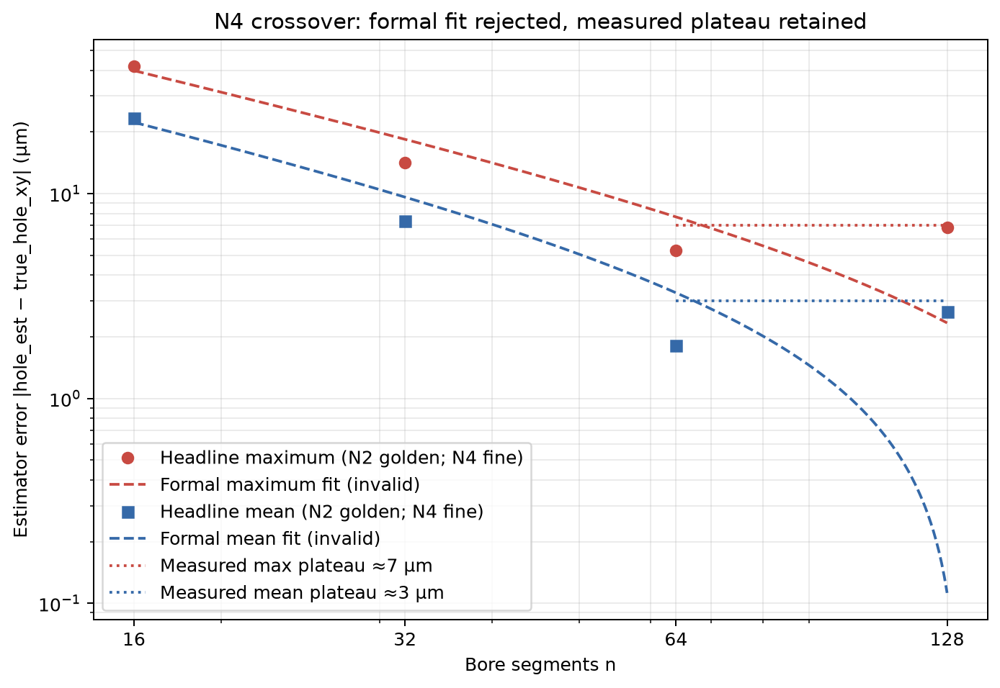
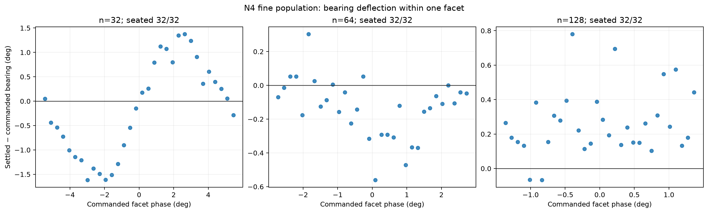
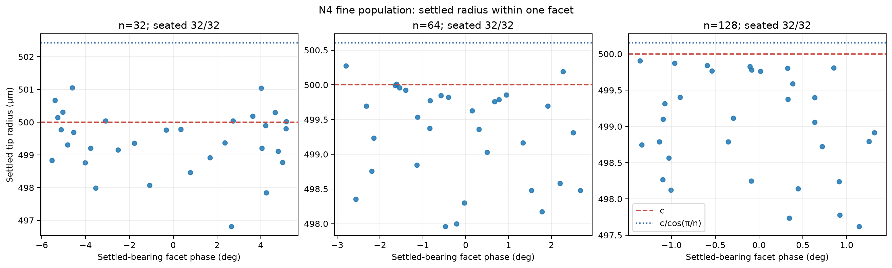
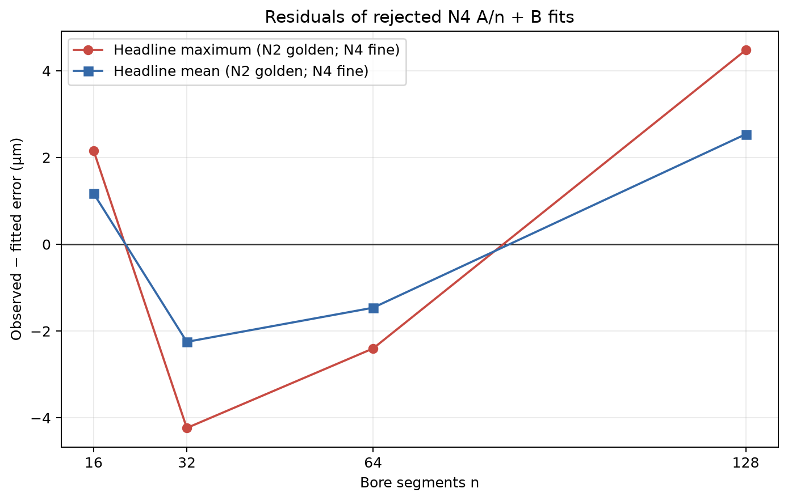

# N4 facet convergence report

Date: 2026-08-09

Repository state entering N4: `7081111` (`104 passed`)

N2 reference evidence: `7081111`

## 1. Outcome

N4 seated 288/288 search-disabled probes while sweeping only the simulated bore resolution through n=32, 64, and 128. Fine-population maximum estimator error measured 14.177, 5.295, and 6.814 µm, and the conservative pooled envelope at n≥64 measured 2.918 µm mean and 6.814 µm maximum; the external geometric-floor claim is therefore rounded up to **3 µm mean and 7 µm maximum**, respectively 170× and 70× below the independent 0.5 mm fault threshold. Facet relief falls as `clearance * (sec(pi/n) - 1)`; penetration first exceeds that relief between n=16 and 32, while the fitted facet harmonic remains strong at n=32 and collapses between n=32 and 64, marking the measured transition from geometry-dominated to contact-solver-dominated error. This establishes the high-resolution deterministic simulation floor for this estimator geometry; it does not establish hardware-rate control, measurement uncertainty, a filter covariance, a production probe cycle, or physical-bore metrology.

## 2. Full measured configuration

The configuration below is the complete configuration used for the N4 physics rollouts. Its core values were printed before execution, and the complete configuration is serialized in the derived summary. `task.n_segments` was the only swept physics parameter. `VALIDATED_LOOSE_V1` itself remained n=16; the n=16 comparison row is committed N2 evidence and was not rerun.

| Group | Value entering N4 |
|---|---|
| Canonical object | `VALIDATED_LOOSE_V1`; canonical `task.n_segments=16` remained unchanged |
| Swept parameter | `task.n_segments in {32, 64, 128}`; one independently built scene/pool per n |
| Task geometry | peg radius 5 mm; radial clearance `c=0.5 mm`; derived hole apothem 5.5 mm; chamfer width 1 mm; plate thickness 10 mm; nominal outer face radius 13.375 mm; peg length 50 mm; blind hole |
| Task inertial/contact | peg mass 0.05 kg; sliding friction 0.4; ring-box tangential overlap factor 1.15 |
| Compiled scene size | `3*n+2` geoms: 98 at n=32, 194 at n=64, 386 at n=128 |
| World/model contact | gravity `(0, 0, -9.81) m/s²`; geom margin 0 m; contact dimension 3; friction vector `(0.4, 0.005, 0.0001)` for sliding/torsional/rolling |
| Peg free-joint terms | damping 0, friction loss 0, and armature 0 on all six DOFs |
| Solver | timestep 0.0005 s; elliptic cone; `implicitfast` integrator; `solref=(0.002, 1)`; specified `solimp=(0.9, 0.95, 0.0001)`; compiled full `solimp=(0.9, 0.95, 0.0001, 0.5, 2)` |
| Translational gains | `k_xy=1000 N/m`; `k_z_search=500 N/m`; `k_z_seating=2000 N/m` |
| Rotational gains | `k_rx=k_ry=5 N·m/rad`; `k_rz=0.05 N·m/rad` |
| Controller dynamics | desired quaternion `(1,0,0,0)`; gravity/bias compensation on; each damping term recomputed as `D_i=2*sqrt(K_i*M_ii)` from the live mass matrix; 10° tilt guard |
| Axial profile | search force 1 N; seating target force 15 N; configured yield invariant 25 N; descent rate 0.01 m/s; search descent allowance 2 mm; raw search target z = -2 mm; raw seating target z = -17.5 mm; force ramp 20 N/s; axial-reference leash active; force-continuous handoff on |
| Commit/gate | depth commit 0.5 mm below `z_flat`; release fraction 0.7, hence release depth 0.35 mm; `z_flat` band 0.25 mm; EMA time constant 0.5 s; alpha 0.001 per control tick; seed `z_flat` from CAD on |
| Episode | z start 5 mm; initial offset radius 1.0 mm; sampled bearing below; plate tilt 0°; maximum 16.3 s = 32,600 physics steps; target depth 9.86 mm = 10 mm plate minus 0.14 mm margin |
| Persistence | seated criterion must hold 0.1 s = 200 consecutive physics samples; settled telemetry is recorded at the completion sample, while `time_to_seat_s` is backdated to the start of that successful streak |
| Grading | `pen_allow=12 µm`, passed explicitly; both tip and mouth lateral radii at most `c+pen_allow=512 µm`; `z_tip<=-9.86 mm`; `F_wedge=inf` (deferred, stored as JSON null) |
| Control timing | `control_decimation=1`; control period 0.0005 s; 2000 Hz; `control_delay_steps=0` |
| Probe | `initial_offset_r=2*c=1.0 mm`; `spiral_spec=None`; estimator `settled_tip_xy - c*[cos(commanded_bearing), sin(commanded_bearing)]`; true hole xy retained in each raw record |
| Referenced n=16 bounds | `R_passive=1.5 mm`; `R_cap_dyn=1.6 mm`; these were not reinterpreted as high-n measurements |
| Inactive canonical spiral | `v_t=5 mm/s`; `a=b=119.366 µm`; pitch 0.75 mm; outer radius 2.75 mm; exhaustion angle 22.03835 rad; integrated tangential path 31.618 mm; continuous coverage 6.32361 s; inactive because `spiral_spec=None` |
| Coarse sampling | 64 bearings per n, `theta_k=k*pi*(3-sqrt(5))`, k=0…63, over the full circle |
| Fine sampling | 32 half-bin bearings over one facet, `theta_k=(k+0.5)*(2*pi/n)/32`, k=0…31, in `[0, 2*pi/n)` |
| Population accounting | 96 trials per n; 288 total; contiguous global trial indices 0…287; results keyed by trial index; coarse, fine, and pooled statistics retained separately |
| Statistics | `numpy.percentile(..., 95)` default linear method; all standard deviations are population values with `ddof=0` |
| Execution | 14 workers; one `ProcessPoolExecutor` per n; each worker called `build_episode_model_data` once and reused only its matching scene; main process alone wrote and flushed JSONL |

No `solref`, `solimp`, timestep, cone, integrator, gain, force, gate, timing, grading, or task value other than `n_segments` changed. The 0.5 mm product fault threshold enters only the report margin calculation, not physics or grading.

## 3. Evidence and reproduction

Durable evidence:

- Driver: [`../scripts/measure_n4_facet_convergence.py`](../scripts/measure_n4_facet_convergence.py)
- Permanent tests: [`../tests/test_n4_facet_convergence.py`](../tests/test_n4_facet_convergence.py)
- Raw JSONL, 288 records: [`../results/n4_facet_convergence_raw.jsonl`](../results/n4_facet_convergence_raw.jsonl)
- Derived summary: [`../results/n4_facet_convergence_summary.json`](../results/n4_facet_convergence_summary.json)
- Estimator/floor figure: [`figures/n4_estimator_error_asymptote.png`](figures/n4_estimator_error_asymptote.png) and [SVG](figures/n4_estimator_error_asymptote.svg)
- Bearing/facet-phase figure: [`figures/n4_bearing_deflection_facet_phase.png`](figures/n4_bearing_deflection_facet_phase.png) and [SVG](figures/n4_bearing_deflection_facet_phase.svg)
- Radius/facet-phase figure: [`figures/n4_settled_tip_radius_facet_phase.png`](figures/n4_settled_tip_radius_facet_phase.png) and [SVG](figures/n4_settled_tip_radius_facet_phase.svg)
- Rejected-fit residual figure: [`figures/n4_asymptote_residuals.png`](figures/n4_asymptote_residuals.png) and [SVG](figures/n4_asymptote_residuals.svg)
- N2 n=16 anchors: [`../results/n2_probe_raw.jsonl`](../results/n2_probe_raw.jsonl) and [`../results/n2_probe_summary.json`](../results/n2_probe_summary.json), both at `7081111`

Exact commands from repository root:

```bash
uv run pytest tests/test_n4_facet_convergence.py -q -x
uv run python scripts/measure_n4_facet_convergence.py --workers 14
uv run python scripts/measure_n4_facet_convergence.py --analyze-only --workers 14
uv run pytest -q
```

The measurement command overwrites the N4 raw JSONL, then derives the summary and all four PNG/SVG pairs. `--analyze-only` reads the committed raw JSONL and performs no physics rollout. Reproduction of the recorded wall-clock values requires 14 workers and remains host-load dependent; the physical outputs are deterministic for the committed configuration.

Commit provenance:

| Evidence state | Commit |
|---|---|
| N2 reference and N4 entry state | `7081111` |
| Initial N4 driver and invariant tests | `36243b2` |
| Completed raw 288-trial sweep | `8422b72` |
| Radial/tangential analysis and invalid-fit handling | `e917fdc` |
| Derived summary and figures | `ef92b1c` |
| Corrected canonical context | `27129c5` |
| Corrected figure population provenance | `f02d904` |
| Survivor-conditioned claim guards | `cf64dcb` |
| Guarded summary/figure refresh | `60c557c` |
| Complete solver-change guard | `2c8ea3a` |

Use the final report commit, shown by `git log -1 --oneline -- docs/N4_FACET_CONVERGENCE_REPORT.md`, for the exact report text and documentation index.

## 4. Engineering decisions

### D1. Stratify global coverage and within-facet resolution

**Problem.** Full-circle uniform samples provide only `N/n` samples per facet and can miss the peak; a within-facet grid alone cannot expose a global-frame offset.

**Decision.** For each n, use 64 full-circle golden-angle bearings plus 32 half-bin samples uniformly covering exactly one facet period.

**Defense.** The design produced 64 coarse and 32 fine successful records at each n. Golden-angle phase increments avoid the zero effective harmonic step of a commensurate grid, while the fine spacing is exactly `(2*pi/n)/32` and avoids both endpoints. The headline maximum comes from the fine population because it resolves the designed within-facet grid.

**Rejected alternatives.** Brute-force full-circle grids waste samples on symmetry-equivalent phases; a 22.5°-style commensurate grid can repeatedly hit one facet phase; a fine-only design cannot inspect world-frame behavior.

### D2. Keep n=16 canonical

**Problem.** N4 needs finer facets, but `R_passive`, `R_cap_dyn`, and all prior capture evidence were measured with the canonical n=16 scene.

**Decision.** Construct trial-local tasks with only `n_segments` replaced by 32, 64, or 128. Leave `VALIDATED_LOOSE_V1.task.n_segments=16` unchanged.

**Defense.** Preflight tests assert that only `TaskSpec.n_segments` differs and that each worker pool has one compatible scene key. Compiled geom counts were 98/194/386, exactly `3*n+2` for the blind-hole scene.

**Rejected alternatives.** Changing the canonical object would silently invalidate capture bounds; mixing n values in one worker initializer risks running a configuration against the wrong MuJoCo model because `run_episode` accepts, but cannot prove, model/config compatibility.

### D3. Scale harmonic order with n

**Problem.** A fixed 16th-harmonic fit would be physically unrelated to the n=32/64/128 facet normals.

**Decision.** Fit coarse signed bearing deflection as `offset + amplitude*sin(n*theta + phi)` using order n for each scene.

**Defense.** The fitted n=32 amplitude is 1.303811° with `R²=0.913805`; the fit then falls to 0.135334°/0.249362 at n=64 and 0.024439°/0.010350 at n=128. The collapsing explained variance is itself the measured crossover evidence.

**Rejected alternatives.** A hard-coded 16th order tests the old scene, not the swept scene. Fitting the fine population would fit only a single local period and give up the coarse population's global-frame diagnostic.

### D4. Isolate penetration at the facet-center minimum

**Problem.** Radius above clearance includes polygonal relief and is not solver penetration.

**Decision.** Define penetration as the signed quantity `clearance - min(pooled settled_tip_radius)`. Compare the pooled maximum separately with the geometric vertex radius `clearance/cos(pi/n)`.

**Defense.** A facet-center plane is geometrically exactly at clearance, so the minimum can move inward only through contact-solver penetration (up to negligible bearing projection effects). The measured values are 7.387, 5.154, 2.963, and 4.117 µm at n=16/32/64/128.

**Rejected alternatives.** `max(radius)-clearance` measures facet relief; clamping penetration to zero hides a solver separation; using only the fine population can miss the global facet-center minimum.

### D5. Treat the requested A/n+B model as a rejected diagnostic

**Problem.** Both headline sequences are non-monotonic: fine maximum is 5.295 µm at n=64 and 6.814 µm at n=128; fine mean is 1.818 and 2.649 µm. An extrapolated intercept from those four points is not a physical asymptote.

**Decision.** Preserve the fitted slope, fitted values, residuals, SSE, and `R²`, but intentionally suppress the intercept and its confidence interval. Use the measured n≥64 envelope, rounded conservatively to 3 µm mean and 7 µm maximum, as the external geometric-floor claim. Publish that envelope only when both pooled high-n populations are complete at 96/96.

**Defense.** The rejected-fit residual changes sign twice and reaches +4.476 µm for the maximum at n=128. In contrast, the n≥64 pooled envelope is directly observed: 2.918 µm mean and 6.814 µm maximum. Against 500 µm these rounded claims give 166.7× and 71.4× margins, stated externally as about 170× and 70×.

**Rejected alternatives.** Publishing the fitted intercept or a t interval would attach inferential meaning to a visibly invalid model. Selecting only n=64 would understate the measured high-n envelope.

### D6. Separate the two crossover boundaries

**Problem.** The work-order wording placed the relief/penetration crossing between n=32 and 64, but the supplied/measured numbers do not: 9.796 µm relief exceeds 7.387 µm penetration at n=16, while 2.419 µm relief is already below 5.154 µm penetration at n=32.

**Decision.** Report the literal magnitude crossing between n=16 and 32, then separately report the response-dominance crossover between n=32 and 64.

**Defense.** The facet harmonic remains strong at n=32 (`R²=0.913805`) even after penetration exceeds static relief; at n=64, relief is only 0.603 µm versus 2.963 µm penetration and harmonic `R²` falls to 0.249362. Geometry controls the directional response through n=32; contact-solver penetration controls the high-n radial floor by n=64.

**Rejected alternatives.** Repeating “relief crosses below penetration between 32 and 64” contradicts arithmetic. Calling the first magnitude crossing the entire response crossover ignores the strong n=32 facet harmonic.

### D7. Decompose error in the commanded probe frame

**Problem.** Error norm alone cannot distinguish inward wall penetration from tangential bearing deflection, and it leaves the next antipodal-cancellation prediction underdetermined.

**Decision.** Project each existing raw error vector onto `u=[cos(theta_cmd), sin(theta_cmd)]` and `u_perp=[-sin(theta_cmd), cos(theta_cmd)]`. Positive radial is outward; positive tangential is counterclockwise. No new physics was run.

**Defense.** At n=64/128, maximum inward radial error is 2.975/4.130 µm, only 0.012/0.013 µm above penetration separately computed from the pooled minimum radius. The remaining n=128 feature is a +2.536 µm pooled signed tangential mean.

**Rejected alternatives.** Projecting on settled bearing mixes the response into its basis; reporting only absolute components hides the n=128 DC sign; inferring components from bearing alone discards radial information already present in raw xy error.

### D8. Leave the n=128 finite-grid uptick unresolved

**Problem.** The fine maximum rises from 5.295 to 6.814 µm, while the fine design has only 32 deterministic phase samples at each n.

**Decision.** Record the difference as unresolved, not as a convergence reversal and not as evidence for a newly theorized mechanism. Identify only the separately measured +2.536 µm tangential DC as unexplained.

**Defense.** A maximum over 32 phase samples is a high-sensitivity order statistic. There is no denser phase grid, repeated grid, or stochastic ensemble from which to resolve a 1.519 µm difference, and N4 contains no noise model from which to assign measurement uncertainty.

**Rejected alternatives.** Mechanism speculation from settled telemetry would outrun the data; the raw schema has no contact IDs, contact counts, or solver residual histories. Calling it a reversal overstates one finite-grid maximum.

### D9. Deviations from the original work order

**Problem.** The accepted post-measurement framing and literal metric definitions conflict with several original reporting instructions.

**Decision.** Make the following deviations explicit:

1. The requested asymptote intercept and confidence interval are not reported because the accepted reframing identifies the model as invalid for the non-monotonic data.
2. The relief/penetration magnitude crossing is reported between n=16 and 32, correcting the arithmetic; the harmonic/dominance crossover remains between n=32 and 64.
3. Vertex comparison uses the literal pooled maximum settled radius. At n=32 that is 501.279 µm versus the fine maximum 501.048 µm; n=64/128 pooled and fine maxima coincide.
4. The measured plateau uses the conservative pooled n≥64 envelope. The formal fine-population fit remains only as the originally specified headline diagnostic.

**Defense.** Each deviation follows either a direct later instruction, a literal reading of “maximum,” or arithmetic in the committed evidence. Population provenance is retained in both summary and report.

**Rejected alternatives.** Silently retaining the original wording would publish an invalid floor, place a crossover at the wrong n interval, or mix fine and pooled maxima without disclosure.

## 5. Measurements

Distances below are µm unless otherwise labeled. Angular values are degrees. Percentiles use NumPy's default linear method; every standard deviation is the population standard deviation with `ddof=0`. N2's n=16 row is a 128-point golden-angle population and has no separate fine population; it is therefore labeled rather than silently pooled with N4.

### 5.1 Capture and exclusions

| n | Population | Captured/trials | Capture (%) | Exclusions | Reasons |
|---:|---|---:|---:|---:|---|
| 16 | N2 golden | 128/128 | 100.0 | 0 | none |
| 32 | coarse | 64/64 | 100.0 | 0 | none |
| 32 | fine | 32/32 | 100.0 | 0 | none |
| 32 | pooled | 96/96 | 100.0 | 0 | none |
| 64 | coarse | 64/64 | 100.0 | 0 | none |
| 64 | fine | 32/32 | 100.0 | 0 | none |
| 64 | pooled | 96/96 | 100.0 | 0 | none |
| 128 | coarse | 64/64 | 100.0 | 0 | none |
| 128 | fine | 32/32 | 100.0 | 0 | none |
| 128 | pooled | 96/96 | 100.0 | 0 | none |

All 288 N4 trial indices were unique and contiguous after sorting. Failure records would have retained an exclusion reason and null settled telemetry, but no N4 failure occurred.

### 5.2 Estimator error by designed population

`error = hole_est_xy - true_hole_xy`, where `hole_est_xy = settled_tip_xy - c*u(commanded_bearing)`.

| n | Population | Mean error (µm) | p95 error (µm) | Maximum error (µm) |
|---:|---|---:|---:|---:|
| 16 | N2 golden | 23.453 | 41.205 | 41.994 |
| 32 | coarse | 7.727 | 13.417 | 14.155 |
| 32 | fine | 7.366 | 13.626 | 14.177 |
| 32 | pooled | 7.607 | 13.580 | 14.177 |
| 64 | coarse | 1.975 | 4.311 | 6.246 |
| 64 | fine | 1.818 | 3.675 | 5.295 |
| 64 | pooled | 1.923 | 4.259 | 6.246 |
| 128 | coarse | 3.052 | 5.732 | 6.132 |
| 128 | fine | 2.649 | 5.674 | 6.814 |
| 128 | pooled | 2.918 | 5.804 | 6.814 |

The specified headline is the fine maximum: 14.177, 5.295, and 6.814 µm. The 1.519 µm difference between n=64 and 128 is unresolved at 32 fine samples; it is not reported as a reversal.

### 5.3 Measured high-n plateau and threshold margin

The plateau is a conservative envelope over pooled n=64 and n=128 results, not a fitted intercept.

| n | Pooled mean error (µm) | Pooled maximum error (µm) |
|---:|---:|---:|
| 64 | 1.923 | 6.246 |
| 128 | 2.918 | 6.814 |
| Measured envelope | **2.918** | **6.814** |
| External claim, rounded upward | **3** | **7** |

| Comparison | Rounded error (µm) | `500 µm / error` | External wording |
|---|---:|---:|---|
| Mean floor | 3 | 166.667× | about 170× below threshold |
| Maximum floor | 7 | 71.429× | about 70× below threshold |

### 5.4 Bearing deflection

Signed deflection is wrapped `settled_tip_bearing - commanded_bearing`; absolute statistics are taken after wrapping.

| n | Population | Mean absolute (°) | p95 absolute (°) | Maximum absolute (°) | Signed mean (°) |
|---:|---|---:|---:|---:|---:|
| 16 | N2 golden | 2.5337 | 4.5873 | 4.6990 | +0.1328 |
| 32 | coarse | 0.8421 | 1.5364 | 1.5780 | +0.0725 |
| 32 | fine | 0.8326 | 1.5555 | 1.6184 | -0.1574 |
| 32 | pooled | 0.8389 | 1.5489 | 1.6184 | -0.0041 |
| 64 | coarse | 0.1540 | 0.4015 | 0.7147 | -0.0841 |
| 64 | fine | 0.1651 | 0.4154 | 0.5610 | -0.1345 |
| 64 | pooled | 0.1577 | 0.4197 | 0.7147 | -0.1009 |
| 128 | coarse | 0.3070 | 0.6054 | 0.6933 | +0.3056 |
| 128 | fine | 0.2711 | 0.6291 | 0.7798 | +0.2628 |
| 128 | pooled | 0.2951 | 0.6175 | 0.7798 | +0.2913 |

### 5.5 Settled tip radius

| n | Population | Mean radius (µm) | Std, ddof=0 (µm) | Minimum (µm) | Maximum (µm) |
|---:|---|---:|---:|---:|---:|
| 16 | N2 golden | 503.000 | 5.579 | 492.613 | 510.414 |
| 32 | coarse | 498.773 | 1.576 | 494.846 | 501.279 |
| 32 | fine | 499.428 | 0.924 | 496.809 | 501.048 |
| 32 | pooled | 498.991 | 1.427 | 494.846 | 501.279 |
| 64 | coarse | 498.840 | 0.729 | 497.037 | 500.261 |
| 64 | fine | 499.286 | 0.678 | 497.957 | 500.276 |
| 64 | pooled | 498.989 | 0.743 | 497.037 | 500.276 |
| 128 | coarse | 498.886 | 0.879 | 495.883 | 499.890 |
| 128 | fine | 499.005 | 0.699 | 497.618 | 499.904 |
| 128 | pooled | 498.926 | 0.825 | 495.883 | 499.904 |

### 5.6 Facet relief, penetration, and vertex check

Facet relief is `c*(sec(pi/n)-1)`. Penetration is `c-min(pooled radius)` and remains signed. The maximum-radius check uses the literal pooled maximum.

| n | Facet relief (µm) | Penetration (µm) | Relief - penetration (µm) | nth-harmonic R² |
|---:|---:|---:|---:|---:|
| 16 | 9.796 | 7.387 | +2.409 | 0.982930 |
| 32 | 2.419 | 5.154 | -2.734 | 0.913805 |
| 64 | 0.603 | 2.963 | -2.360 | 0.249362 |
| 128 | 0.151 | 4.117 | -3.966 | 0.010350 |

The static relief/penetration magnitude crossing is between n=16 and 32. The response remains strongly facet harmonic at n=32; its transition to contact-solver dominance occurs between n=32 and 64, where relief is five times smaller than penetration and harmonic `R²` collapses from 0.914 to 0.249.

| n | Predicted vertex `c/cos(pi/n)` (µm) | Measured pooled max radius (µm) | Measured - predicted (µm) |
|---:|---:|---:|---:|
| 16 | 509.796 | 510.414 | +0.618 |
| 32 | 502.419 | 501.279 | -1.140 |
| 64 | 500.603 | 500.276 | -0.327 |
| 128 | 500.151 | 499.904 | -0.247 |

The geometric vertex value is an unpenetrated bound, not a promise that a 32-point settled trajectory hits the exact vertex with zero solver penetration.

### 5.7 Coarse nth-harmonic fits

The phase convention is `offset + amplitude*sin(n*theta + phi)`. `phi` is the phase of the harmonic argument; positive-peak facet phase is reported in bearing-axis degrees. Phases at n=64/128 are numerically defined but should not be physically interpreted when `R²` is low.

| n/order | Coarse fit N | Amplitude (°) | Constant offset (°) | Phase phi (°) | Positive-peak facet phase (°) | R² |
|---:|---:|---:|---:|---:|---:|---:|
| 16 | 128 | 4.087712 | +0.101568 | -0.987022 | 5.686689 | 0.982930 |
| 32 | 64 | 1.303811 | +0.069719 | -0.987127 | 2.843348 | 0.913805 |
| 64 | 64 | 0.135334 | -0.082619 | -150.304338 | 3.754755 | 0.249362 |
| 128 | 64 | 0.024439 | +0.305785 | +66.490092 | 0.183671 | 0.010350 |

N2's n=16 fit uses its complete golden-128 population because no N2 coarse/fine split exists. N4 fits use coarse populations only, as specified.

### 5.8 Radial/tangential error decomposition

For commanded bearing `theta`, radial positive is outward along `u=(cos(theta),sin(theta))`; tangential positive is counterclockwise along `u_perp=(-sin(theta),cos(theta))`. “Maximum inward” is the magnitude of the most negative radial sample. The identity `error_norm² = radial² + tangential²` was asserted for every successful record.

| n | Population | Radial signed mean (µm) | Radial RMS (µm) | Maximum inward radial (µm) | Penetration (µm) | Inward - penetration (µm) |
|---:|---|---:|---:|---:|---:|---:|
| 16 | N2 golden | +2.352 | 6.009 | 7.633 | 7.387 | +0.246 |
| 32 | pooled | -1.079 | 1.789 | 5.227 | 5.154 | +0.073 |
| 64 | pooled | -1.015 | 1.257 | 2.975 | 2.963 | +0.012 |
| 128 | pooled | -1.083 | 1.363 | 4.130 | 4.117 | +0.013 |

| n | Population | Tangential signed mean (µm) | Tangential mean absolute (µm) | Tangential RMS (µm) | Tangential maximum absolute (µm) |
|---:|---|---:|---:|---:|---:|
| 16 | N2 golden | +1.207 | 22.246 | 25.542 | 41.427 |
| 32 | pooled | -0.032 | 7.306 | 8.375 | 14.151 |
| 64 | pooled | -0.879 | 1.373 | 1.848 | 6.232 |
| 128 | pooled | +2.536 | 2.569 | 2.964 | 6.799 |

The high-n radial equality is sharp: inward radial extreme and independently computed penetration differ by only 0.012 µm at n=64 and 0.013 µm at n=128. This establishes penetration as the high-n radial floor. It does **not** show that the total n=64 error tail is radial-dominated: tangential RMS is 1.848 µm versus radial RMS 1.257 µm, and tangential maximum is 6.232 µm versus 2.975 µm maximum inward radial. At n=128 the +2.536 µm tangential signed mean is the unresolved DC term.

For population sensitivity, n=64 fine radial/tangential RMS values are 0.988/1.898 µm and n=128 fine values are 1.223/2.807 µm; the coarse values are 1.372/1.822 µm and 1.427/3.040 µm, respectively. The component conclusion is therefore not created by pooling.

### 5.9 Wall-clock

Individual rollout times overlap across workers; batch elapsed is the actual per-n parallel wall time including pool startup and model builds. N2 did not save rollout wall-clock and is reported unavailable rather than reconstructed from simulation time-to-seat.

| n | Geoms | Rollout mean (s) | Rollout std, ddof=0 (s) | Rollout p95 (s) | Rollout max (s) | Batch elapsed (s) | Batch elapsed/trial (s) |
|---:|---:|---:|---:|---:|---:|---:|---:|
| 16 | 50 | unavailable | unavailable | unavailable | unavailable | unavailable | unavailable |
| 32 | 98 | 6.778 | 0.438 | 7.350 | 8.188 | 48.459 | 0.505 |
| 64 | 194 | 7.914 | 0.356 | 8.390 | 8.571 | 56.252 | 0.586 |
| 128 | 386 | 10.654 | 0.756 | 12.035 | 12.467 | 75.836 | 0.790 |

The three N4 batches totaled 180.547 s, or 0.627 s/trial amortized with 14 workers. From n=32 to 128, geom count grew 3.939× while mean rollout and batch elapsed grew 1.572× and 1.565×; broadphase/contact cost did not explode over this range.

### 5.10 Requested asymptote fit, rejected for floor inference

The requested four-point model was fit to the exact specified provenance. Each two-parameter fit has two residual degrees of freedom. Because each observed sequence is non-monotonic, the intercept and its confidence interval are intentionally not reported. They are also absent from the committed derived summary. No value from this fit is used as the external floor.

| Fit | Population provenance | A (µm·segments) | SSE (µm²) | R² | Monotonic? | Valid for floor? |
|---|---|---:|---:|---:|---|---|
| Headline maximum | n=16 N2 golden max; n≥32 N4 fine max | 685.684 | 48.359 | 0.944630 | no | no |
| Headline mean | n=16 N2 golden mean; n≥32 N4 fine mean | 405.368 | 14.996 | 0.950566 | no | no |
| Pooled-mean sensitivity | n=16 N2 golden mean; n≥32 N4 pooled mean | 401.533 | 14.989 | 0.949684 | no | no |

| n | Max observed (µm) | Max fitted (µm) | Max residual (µm) | Mean observed (µm) | Mean fitted (µm) | Mean residual (µm) |
|---:|---:|---:|---:|---:|---:|---:|
| 16 | 41.994 | 39.837 | +2.157 | 23.453 | 22.281 | +1.172 |
| 32 | 14.177 | 18.409 | -4.233 | 7.366 | 9.613 | -2.247 |
| 64 | 5.295 | 7.695 | -2.400 | 1.818 | 3.279 | -1.461 |
| 128 | 6.814 | 2.339 | +4.476 | 2.649 | 0.112 | +2.537 |

The residual sign pattern and the n=128 misses demonstrate why a high `R²` alone does not validate extrapolation. The measured plateau in Section 5.3 replaces—not renames—the invalid intercept.

## 6. Figures

### 6.1 Estimator error versus bore segments



**Figure 1.** Log-log estimator error versus n. The n=16 points are N2 golden-128 statistics; n≥32 points are N4 fine statistics. Dashed curves show the requested formal fits only to expose their failure; dotted horizontal segments show the directly measured, conservatively rounded n≥64 plateau. Look for the non-monotonic n=64→128 points and the dashed curves diverging from them rather than approaching the plateau.

### 6.2 Bearing deflection within one facet



**Figure 2.** Fine-population signed bearing deflection versus commanded facet phase, one panel per swept n. Look for the smooth n=32 facet curve disappearing by n=64 and for the positive n=128 offset. Axis ranges intentionally differ so each 32-point curve remains legible; compare the numeric tables, not visual height alone.

### 6.3 Settled tip radius within one facet



**Figure 3.** Fine-population settled tip radius versus settled-bearing facet phase, with `c=500 µm` and the unpenetrated polygon vertex radius `c/cos(pi/n)` drawn as horizontal bounds. Settled-bearing phase is used here because the geometric radius bound applies at the realized contact bearing. Look for relief shrinking below the inward contact-solver displacement by n=64; points below `c` measure penetration, whereas values above `c` are allowable polygon relief.

### 6.4 Residuals of the rejected formal fit



**Figure 4.** Observed-minus-fitted residuals for the requested maximum and mean fits. The hybrid population provenance is explicit in the legend. Look for alternating residual signs and the positive n=128 misses; these are the direct reason the model's intercept and confidence interval are not used or reported.

## 7. Predictions versus measurements

The six original point predictions are compared with the specified fine-population maxima. “Falsified” means the stated numeric prediction was not reproduced; it does not imply that a lower error is undesirable, and it does not assign a mechanism to the unresolved n=128 finite-grid maximum.

| n | Quantity | Predicted | Measured | Measured - predicted | Status |
|---:|---|---:|---:|---:|---|
| 32 | Maximum bearing deflection | 2.35° | 1.618° | -0.732° | falsified |
| 32 | Maximum estimator error | 20.5 µm | 14.177 µm | -6.323 µm | falsified |
| 64 | Maximum bearing deflection | 1.17° | 0.561° | -0.609° | falsified |
| 64 | Maximum estimator error | 10.2 µm | 5.295 µm | -4.905 µm | falsified |
| 128 | Maximum bearing deflection | 0.59° | 0.780° | +0.190° | falsified |
| 128 | Maximum estimator error | 5.1 µm | 6.814 µm | +1.714 µm | falsified |

Additional work-order predictions and checks:

| n/range | Prediction or check | Predicted | Measured | Difference | Status |
|---:|---|---:|---:|---:|---|
| 32 | Penetration | about 8 µm | 5.154 µm | -2.846 µm | falsified |
| 64 | Penetration | about 8 µm | 2.963 µm | -5.037 µm | falsified |
| 128 | Penetration | about 8 µm | 4.117 µm | -3.883 µm | falsified |
| 32 | Capture | 96/96 | 96/96 | 0 | confirmed |
| 64 | Capture | 96/96 | 96/96 | 0 | confirmed |
| 128 | Capture | 96/96 | 96/96 | 0 | confirmed |
| 32 | Vertex radius check | 502.419 µm | 501.279 µm | -1.140 µm | confirmed as upper bound |
| 64 | Vertex radius check | 500.603 µm | 500.276 µm | -0.327 µm | confirmed as upper bound |
| 128 | Vertex radius check | 500.151 µm | 499.904 µm | -0.247 µm | confirmed as upper bound |
| 32 | Dominant nth harmonic | strong | `R²=0.913805` | — | confirmed |
| 64 | Dominant nth harmonic | strong | `R²=0.249362` | — | falsified |
| 128 | Dominant nth harmonic | strong | `R²=0.010350` | — | falsified |
| 32→128 | Runtime does not explode with facets | roughly linear or better | 3.939× geoms; 1.572× rollout time | qualitative | confirmed |

The penetration prediction failed without a spike: all values stayed below 5.154 µm and capture remained complete. The facet-relief values themselves—9.796, 2.419, 0.603, and 0.151 µm at n=16/32/64/128—are exact geometry, not fitted predictions. Exact n-fold periodicity across different facets was not directly tested because the design has no repeated identical local phase in multiple facets; the table's harmonic rows test dominance by one nth sinusoid, not group-theoretic periodicity.

## 8. What this does not establish

- Every rollout used `control_decimation=1`: 2000 Hz and zero delay. L3 measured 1000 Hz and 500 Hz at 0/16 captures because all 16/16 trials at each rate tripped the 10° tilt guard at first plate contact. N4 therefore does not establish hardware-plausible control timing.
- The simulation contains no injected sensor, actuation, fixture, or part noise. Trial spread here comes from designed bearing/phase variation, not repeated noisy measurement. No statistic in this report is a measurement uncertainty, confidence interval for hardware, or Kalman-filter `R` matrix.
- The 3 µm mean/7 µm maximum plateau is the hardware-transferable **geometric estimator-floor claim** from this deterministic model. It does not include physical bore roundness tolerance, part tolerance, compliance, calibration, sensor noise, or robot pose error.
- Bore faceting is a simulation artifact. A real nominal bore is round, so the n-fold relief and bearing-normal deflection do not transfer to hardware.
- The report does not validate a production probe sequence, a probe cycle state machine, a Kalman filter, a recovery demonstration, a taught-position baseline, or tight-clearance insertion. None was built.
- The search spiral was structurally disabled. N4 establishes only the search-disabled measurement primitive inside the previously measured n=16 passive/dynamic capture bounds.
- The n=128 fine maximum is a maximum over 32 deterministic phase samples. N4 supplies neither the denser grid nor repeated sample sets needed to resolve its 1.519 µm difference from n=64.
- The +2.536 µm n=128 tangential DC is measured but unexplained. Settled telemetry lacks contact IDs/counts, solver residuals, and transient trajectories needed to localize it.
- Low nth-harmonic `R²` shows that a single nth sinusoid no longer explains coarse deflection. It does not, by itself, prove loss of exact n-fold symmetry.
- Wall-clock values characterize this host, 14-worker execution, and current load. They are not real-time controller benchmarks.

## 9. Tests added or strengthened

The new N4 test module contains 16 non-rollout tests:

1. Exact 288-trial stratified design, counts, golden-angle formula, half-bin fine formula, spacing, and open interval.
2. Only `TaskSpec.n_segments` differs from canonical; canonical remains n=16; one scene key per n.
3. Estimator direction and facet phase use commanded geometry.
4. Harmonic recovery uses the requested order and declared phase convention rather than hard-coding 16.
5. Constant-signal harmonic handling returns undefined phase/`R²` safely.
6. Exact `A/n+B` synthetic recovery.
7. Independent noisy-reference t-interval arithmetic for the pure fitter.
8. Non-monotonic summary handling suppresses the non-physical intercept and CI.
9. Population statistics use `ddof=0` and exclude failure telemetry.
10. Penetration remains signed and vertex radius derives from the clearance apothem.
11. Radial/tangential decomposition uses the commanded probe frame and reconstructs the vector norm.
12. Shuffled records are keyed/sorted and coarse, fine, and pooled populations remain separate.
13. Fine exclusions invalidate formal fits while preserving diagnostic figures.
14. Sparse high-n coarse capture suppresses survivor-conditioned plateau/crossover claims while preserving figures.
15. A constant harmonic preserves null `R²` and an unavailable crossover rather than aborting analysis.
16. The n=16 reference is anchored to the exact committed N2 evidence.

| Test stage | Command | Result |
|---|---|---:|
| Entry baseline at `7081111` | `uv run pytest -q` | 104 passed |
| Targeted N4 verification | `uv run pytest tests/test_n4_facet_convergence.py -q -x` | 16 passed |
| Final repository verification | `uv run pytest -q` | 120 passed |

## 10. Commit-by-commit traceability

| Commit | Purpose | Why separate |
|---|---|---|
| `7081111` | Accepted N2 evidence and N4 baseline | Preserves the exact n=16 anchor and 104-test entry state |
| `36243b2` | Add N4 driver and initial permanent tests | Behavior and invariants precede measurement evidence |
| `8422b72` | Commit 288 raw rollout records | Measurement data is not squashed with analysis changes |
| `e917fdc` | Add radial/tangential decomposition, conservative plateau, and invalid-fit suppression | Derived interpretation is reviewable independently of physics |
| `ef92b1c` | Commit derived summary and four figure pairs | Generated evidence has a stable provenance point |
| `27129c5` | Correct `CONTEXT.md` against code and N4 evidence | Canonical-state corrections remain distinct from the technical report |
| `f02d904` | Correct hybrid N2/N4 plot labels and log-axis ticks | Presentation/provenance correction contains no new physics |
| `cf64dcb` | Gate plateau/crossover claims on complete populations and preserve unavailable harmonics | A future capture falsification cannot become a survivor-conditioned external claim |
| `60c557c` | Refresh summary and figures with explicit claim availability | Derived evidence follows the guarded analysis without rerunning physics |
| `2c8ea3a` | Add `integrator` to the canonical stop-and-ask solver guard | Completes the work-order protection without mixing it into the report commit |
| Report documentation commit | Add this report and documentation index; record final tests | Discover exactly with `git log -1 --oneline -- docs/N4_FACET_CONVERGENCE_REPORT.md` |

No commit squashes a physics behavior change with raw evidence or documentation.

## 11. Context corrections

`CONTEXT.md` was read first and checked against source and compiled models. It was wrong in the following places and now says:

| Prior claim | Code/evidence check | Correction made in `27129c5` or `2c8ea3a` |
|---|---|---|
| `InsertionProfile` was listed in `pegsim/control.py` | It is defined in `pegsim/rollout.py` | Repo map now lists its actual owner |
| Force governors cap commanded force, so the absent safety module does not block sim | `f_yield` only validates `f_target<f_yield`; no runtime wrench clamp exists | Context now distinguishes nominal axial-reference governors from an independent hardware safety layer |
| The scene has 50 geoms | That is only canonical n=16; blind scenes have `3*n+2` | Context gives the formula and N4 counts 98/194/386; through-hole count is `3*n+1` |
| The 5.5/6.5/13.375 mm silhouette applies at facet centers and boundaries, with nothing farther out | Those radii are exact only at facet centers; n=16 boundary faces are 5.6077/6.6275/13.637 mm and overlap corners reach about 13.7045 mm | Context now describes the polygonal silhouette and deliberate overlap |
| `z_flat` EMA alpha is `dt/tau` | Code uses `min(1, control_decimation*dt/tau)` | Context now states control-period scaling and canonical alpha 0.001 |
| Spiral “arc” is 31.62 mm | Code integrates tangential distance `integral r dtheta`; exact Archimedean curve arc is a different quantity | Context now calls 31.62 mm the integrated tangential path |
| `tip_lateral≈0.5079 mm` implied about 8 µm penetration | Radius above clearance is polygon relief | Context now cites isolated N2 penetration `c-min(radius)=7.3869 µm` |
| `run_episode` is literally the only physics-stepping path in the repository | Retained legacy diagnostics and UI/test code call `mj_step` directly | Context now scopes the rule to all new measurement/diagnostic work and names legacy tools as non-current evidence |
| Solver-change guard omitted `integrator` | The N4 work order protects `solref`, `solimp`, timestep, cone, and integrator together | Context now requires stopping before changing any of the five |
| No N4 canonical state existed | Committed N4 raw/summary evidence measures the high-n floor and crossover | Context now records the 3/7 µm plateau, both crossover boundaries, and unresolved n=128 tangential DC |

The prior N2 capture, estimator-error, bearing-error, and canonical n=16 configuration numbers matched code/evidence and were not changed.

## 12. Remaining risks and next checkpoint

Ordered by severity:

1. **Hardware-rate control remains blocking.** N4 runs only at the 2000 Hz zero-delay simulation condition that L3 showed does not survive decimation to 1000 or 500 Hz. No N4 geometric margin repairs that control-stability failure.
2. **The queued N5 “radial-dominated single-probe error” clause is not supported component-wise by N4.** At n=64, the fine maximum norm is 5.295 µm, but that trial contains 2.066 µm radial and 4.876 µm tangential magnitude. Pooled radial/tangential RMS is 1.257/1.848 µm. What N4 establishes sharply is that maximum inward radial error equals penetration to 0.012 µm; N5 must treat total-error dominance as a falsifiable prediction, not an established premise.
3. **n=128 tangential DC remains unexplained.** The pooled signed value is +2.536 µm and dominates its signed radial mean magnitude. N4 lacks contact-manifold and solver-history telemetry needed to attribute it.
4. **The n=64→128 fine-maximum change is unresolved.** Thirty-two phase points do not resolve whether 5.295 versus 6.814 µm reflects the finite phase grid or a stable high-n change. It is not evidence of reversal.
5. **The external floor excludes hardware uncertainty.** The 3/7 µm claim is geometric and deterministic; real tolerance, calibration, compliance, sensing, and control-rate error remain unmeasured.
6. **Exact cross-facet periodicity was not directly replicated.** A future mechanism study would need same-local-phase probes across several facets and contact/solver telemetry, but that is not required before the specified N5 cancellation test.

The next queued checkpoint is **N5 antipodal cancellation with injected part-tolerance DC**, not started here. Its specified run is n=64, injected DC in `{-10, -5, 0, +5, +10} µm`, and 64 antipodal pairs per level. Pre-registered targets are approximately 5 µm single-probe norm, approximately 2.7 µm antipodal-mean error, radial penetration cancellation in the mean, and a difference term equal to the injected DC plus a constant of twice the measured n=64 penetration (`2*2.963=5.926 µm`). The N4 decomposition refines the audit criterion: separately report radial and tangential components, because the single-probe high-error tail at n=64 is measured as tangential-dominated even though penetration fixes the inward radial extreme.

N5 and N3 were not started.
